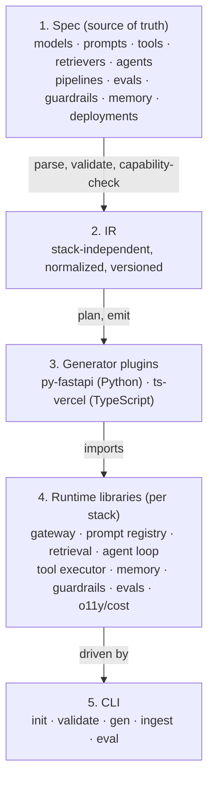

# AID Framework

**AID** (AI Development Framework) lets you *declare* an AI application once — models, prompts, tools,
retrieval, agents, pipelines, evals, guardrails, memory, and deployments — and compile it into idiomatic,
runnable AI services across multiple language stacks.

> **Status: pre-alpha.** [`docs/design.md`](docs/design.md) is the authoritative design document. The
> shipped surface covers Phase 0 and Phase 2: the spec DSL, the IR, the generator SDK, the Python and
> TypeScript runtimes, two targets, the `aid` CLI, and three example apps. Phase 2's exit criterion is met:
> every pipeline step kind is supported, and `DEFERRED_STEP_KINDS` is empty.
>
> The CLI implements exactly five commands: `init`, `validate`, `gen`, `ingest`, and `eval`.
> The seven commands specified but not implemented are `dev`, `trace`, `cost`, `guard`, `migrate`, `eject`, and `doctor`.
> The project is pre-alpha and not production-ready.

The documentation site — quickstart, spec and CLI references, and both walkthroughs — is published at
<https://aid-framework.github.io/aid-framework/>.

## The problem

Every AI app re-implements the same 70–85% of non-differentiating plumbing: provider adapters and streaming,
retries and rate limits, token/cost budgeting, prompt templating and versioning, structured-output
enforcement, RAG ingestion and retrieval, agent loops and tool execution, memory, guardrails, tracing,
caching, and evals. None of it is the product, and most of it is easy to get subtly wrong.

AID Framework makes that tier *generated, correct, traced, and regenerable*, so you spend your time on the
parts that are actually yours: **domain prompts, domain tools, and evaluation criteria**.

## How it works

A single declarative spec is validated and normalized into a stack-independent IR; generator plugins turn
that IR into small, declarative glue; hand-written per-stack runtime libraries provide the behavior; the CLI
drives the whole loop.



Two correctness regimes ship together from day one: **golden-file tests** verify generated *code*, and an
**eval harness** verifies model *behavior*. See [`docs/design.md`](docs/design.md) for the full architecture,
the IR, the CLI surface, and the roadmap.

## What ships today

- **Targets:** `py-fastapi` (Python) and `ts-vercel` (TypeScript).
- **Pipeline step kinds:** `generate`, `retrieve`, `tool`, `emit`, `branch`, `parallel`, `map`, `reduce`, `rerank`, `guard`, and `agent` — `DEFERRED_STEP_KINDS` is empty, so none is deferred.
- **Conformance corpus:** 73 language-neutral cases run against both the Python and TypeScript runtimes.

## Repository layout

| Path | Responsibility |
| --- | --- |
| [`docs/`](docs/) | Design documentation. [`docs/design.md`](docs/design.md) is authoritative. |
| [`packages/spec/`](packages/spec/) | The declarative spec DSL plus JSON Schema, parser, and validator. |
| [`packages/ir/`](packages/ir/) | The stack-independent IR: types, builder, normalization, validation. |
| [`packages/generator-sdk/`](packages/generator-sdk/) | The generator plugin interface and determinism contract. |
| [`packages/generators/`](packages/generators/) | Generator plugins, one per target stack. |
| [`packages/cli/`](packages/cli/) | The command-line interface. |
| [`runtimes/`](runtimes/) | Hand-written per-stack runtime libraries — the real framework. |
| [`examples/`](examples/) | Example specs and generated apps. |

## Quickstart

The CLI is published, so nothing needs to be cloned. You need Node.js 24 or newer:

```bash
npx @aid-framework/cli init my-app
cd my-app
npx @aid-framework/cli validate   # spec → IR → every build-time gate
npx @aid-framework/cli gen        # compile the spec into a runnable service
```

The default target is `py-fastapi`, and the generated routers import
[`aid-runtime-python`](https://pypi.org/project/aid-runtime-python/). The ASGI entry point is yours — a few lines
in `app/main.py` mounting the generated routers:

```python
from fastapi import FastAPI
from app.generated.routes.answer_ticket import answer_ticket_router

app = FastAPI()
app.include_router(answer_ticket_router)
```

```bash
pip install aid-runtime-python "fastapi>=0.115,<1" "uvicorn>=0.30,<1"
uvicorn app.main:app --reload
```

Use `--target ts-vercel` for the TypeScript / Vercel target, which pairs with
[`@aid-framework/runtime`](https://www.npmjs.com/package/@aid-framework/runtime). A spec declares the targets it
is for; `--target` selects among them. [`packages/cli/`](packages/cli/) documents every command and the exit-code
contract.

## Working on the framework itself

You need Node.js 24 (see [`.nvmrc`](.nvmrc)) and [uv](https://docs.astral.sh/uv/); `corepack enable` puts
pnpm on your PATH.

```bash
corepack enable
pnpm install --frozen-lockfile
pnpm build

cd examples/support-copilot
node ../../packages/cli/dist/cli.js validate       # spec → IR → every build-time gate
node ../../packages/cli/dist/cli.js gen --dry-run  # report the change set, and write nothing
node ../../packages/cli/dist/cli.js gen            # reconcile the tree with the spec
```

Scaffolding from the checkout, and the options every command takes:

```bash
node packages/cli/dist/cli.js init my-app --gen                      # from a starter spec
node packages/cli/dist/cli.js init my-app --from app.spec.yaml --gen # importing an existing spec
node packages/cli/dist/cli.js <command> --help
```

`aid eval` runs the project's generated eval module through the Python toolchain and gates on regressions,
so its dependencies have to be installed first
(`uv pip install -e runtimes/python -e examples/support-copilot`). [`packages/cli/`](packages/cli/) documents
each command; [`examples/support-copilot/`](examples/support-copilot/) is the runnable end-to-end example.

## Contributing

Contributions are welcome — prompts, tools, rubrics, generators, runtimes, docs, and bugs. We use the
**Developer Certificate of Origin (DCO)**, not a CLA: sign off your commits with `git commit -s`.

See [`CONTRIBUTING.md`](CONTRIBUTING.md) for development setup and pull request expectations, and
[`CODE_OF_CONDUCT.md`](CODE_OF_CONDUCT.md) for community standards. Security issues: see
[`SECURITY.md`](SECURITY.md).

## Licensing

AID Framework is licensed under the [Apache License 2.0](LICENSE). See [`NOTICE`](NOTICE) for attribution.

> **Generated-output carve-out:** The AID Framework is licensed under Apache-2.0. Code generated by AID
> Framework is not subject to the AID Framework's license — you own it and may license it however you wish.
