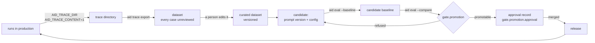

# Improving an agent over time

An AID agent is a document plus the code around it, so improving one is a change to a file
in a branch — measured, approved and merged like any other change. There is no training
loop, no hosted experiment tracker and no service that promotes anything: the loop below is
a chain of artifacts in git, and every link in it is a command that already ships.

This page is the order to run them in, what each one refuses, and the two things a
recording can and cannot prove.



Nothing in this diagram runs on a schedule or on its own. The one arrow that is not a
command is `merged`, and that is deliberate.

## 1. Turn on the two variables that make a run exportable

The runtime writes a local JSONL trace only when `AID_TRACE_DIR` names a directory, and it
records prompt and completion text only when `AID_TRACE_CONTENT=1` asks for it. Text is the
whole reason a trace becomes a dataset — without it there is no case, and re-asking the
model would answer a different question while looking like an answer to this one.

```bash
AID_TRACE_DIR=./traces AID_TRACE_CONTENT=1 uvicorn app.main:app
```

`AID_TRACE_CONTENT=1` is also the reason `observability.redact` matters before you turn it
on rather than after. The generated app replaces every field the spec withholds as it
records the prompt, so the captured copy never held the value. Redaction decides what is
recorded, never what is asked: the model still receives the original text. A field name
cannot be stripped out of prose afterwards, which is exactly why the stripping happens at
capture.

## 2. Export the runs as a dataset

```bash
aid trace export --dataset refunds --from ./traces --out app/evals/refunds.json
```

One run is one case: the prompt the run was first given, the answer it last produced, and
the calls, cost, wall time, model and tools beside it. `--filter agent=<id>` keeps only the
runs whose agent span names that agent, which is how a dataset for one agent is taken out of
a sink that holds several.

Every case is tagged `unreviewed`, because `expected` is what the run happened to output.
That is a record of behaviour, not a judgement about a good answer, so an `exact` metric
against it measures stability rather than quality — any good rewording fails it. The tag is
operative:

- a `gate.ci: true` eval refuses a dataset that still carries it, naming up to five of the
  cases;
- a `gate.ci: false` eval may use one as it is, which is how you get a number to look at
  without letting an unexamined expectation decide whether a change ships.

Under `profile: enterprise` the export itself refuses a document whose withheld set is
empty. A deployment that has said nothing about what may leave it has no policy for the
command to apply, so exporting its text would be an assumption rather than a policy.

## 3. Curate, then version the dataset

Wire the file into the spec and read the cases:

```yaml
evals:
  refund_trajectory:
    target: agent:refund_agent
    dataset:
      source: file
      uri: evals/refunds.json
    metrics:
      - kind: tool-trace
        expect: [lookup_customer, issue_refund]
        ordered: true
      - kind: cost
        max: 0.05
```

The URI is app-relative, the way `app/evals/tickets.jsonl` is written `evals/tickets.jsonl`,
so the export above lands exactly where this reads it. `metrics` is required on every eval and
the dataset supplies the cases, not the expectations: `tool-trace` takes its sequence from the
spec, so a freshly exported recording can be measured before anyone has judged its answers.
Each tool named there has to be a tool the agent may call — an unknown one is refused at build
time as `ir/metric-tool-unresolved`, because an expectation about a tool that cannot be called
measures nothing.

The version is not a spec key: it lives in the dataset file itself, beside `name` and `cases`,
and `--version` is what sets it on an export (`1` when you do not pass one). A baseline records
the dataset it was measured on as `name@version`, so bumping it is the deliberate act that marks a
curation pass — and `aid eval --compare` refuses to compare across versions rather than reading a
moved dataset as a moved model.

Curating is a person editing the file — dropping the `unreviewed` tag, fixing an `expected`
that records a bad answer, removing a case that should not exist. Bump `version` in that same
edit, because the file is what the eval reads. Re-exporting instead is a different act: it
regenerates the cases from the sink (and needs `--force` to overwrite), which discards the
curation and is the right move only when the runs, rather than the judgements, are what changed.

## 4. Make the candidate a different version of the same thing

`gate.promotion.baseline` names the prompt version the candidate replaces, and the spec must
declare a strictly greater version for the candidate. The build refuses the alternative
(`ir/prompt-version-stale`): a promotion that names the version already in force has nothing
to promote, and a template edited without a bump would make two different prompts answer to
one identity.

```yaml
prompts:
  classify_claim:
    version: 2   # was 1; model, template and output are unchanged
evals:
  triage_regression:
    target: pipeline:triage
    metrics:
      - kind: json-schema
        schema: TicketClassification
      - kind: cost
        max: 0.02
    gate:
      ci: true
      maxRegression: 0.05
      minMean: 0.8
      promotion:
        allowedQualityDrop: 0.01
        allowedCostIncrease: 0.10
        baseline:
          prompt: classify_claim
          version: 1
        approval:
          by: [platform-lead]
          record: app/approvals/triage.md
```

For an agent, the candidate is also where a recording belongs. A trajectory eval driven by a
scripted model verifies the policy and the plumbing around the model — that the approval was
respected, that the step count stayed inside its bound, that a forbidden tool was not called.
It does not verify the model's behaviour, and repeating it does not make it evidence about a
new prompt. Capture a real run instead:

```bash
aid eval --suite refund_trajectory --record app/evals/refund_trajectory.transcript.json
```

That writes the model calls of one live run, which the module replays through
`AID_EVAL_TRANSCRIPT` on every later run, with no key and no spend. The eval summary prints a
`provenance:` line saying which of the two it just measured — `scripted`, `recorded` or
`live` — so a reader never has to guess. Recording is never automatic: it needs the flag, it
costs one live run, and it refuses to overwrite a transcript, to capture a scripted provider,
or to capture while replaying.

## 5. Record the accepted and the candidate baseline

`--baseline` always writes the module's own path, `app/evals/<eval>.baseline.json`, so the two
sides of the comparison are kept under names you choose:

```bash
# in the candidate tree, with the baseline currently in force in place
cp app/evals/triage_regression.baseline.json accepted.json
aid eval --suite triage_regression --baseline
cp app/evals/triage_regression.baseline.json candidate.json
```

The first copy is taken before the re-record, so `accepted.json` is the measurement in force and
`candidate.json` is the same measurement taken after your change. A baseline is the metric means
of the run that produced it, next to that run's spend and wall time when the runtime metered
them. The block is written only when the run metered it, so "spent nothing" and "did not measure"
stay distinguishable — which matters in step 6.

## 6. Apply the promotion policy

```bash
aid eval --compare accepted.json --candidate candidate.json
```

Run it from the project root, since the policy it applies is read from the spec there. When
more than one eval declares a promotion policy, `--suite` names the one the two files belong
to; with exactly one, it is inferred.

The report gives a verdict, and the exit code is the gate:

```text
promotion of eval "triage_regression" over dataset triage@1

  ok   json-schema      accepted  90.00%  candidate  93.00%  change   +3.00%  allowance 1.00%

  verdict: promotable
```

`refused` and exit 1 for any of these, and each names the fix:

| Refusal | Code | What it means |
| --- | --- | --- |
| A metric dropped further than the allowance | `cli/eval-compare-regressed` | The candidate is worse than what is in force. Improve it, or raise `allowedQualityDrop` and say why in the commit that raises it. |
| Spend per run rose further than the allowance | `cli/eval-compare-cost-regressed` | The candidate answers well and costs more. Both dollar figures are printed. |
| An allowance neither file can judge | `cli/eval-compare-cost-unjudged` | One side recorded no spend, so the allowance has nothing to compute a fraction of. A cost allowance is refused as unjudged rather than passed — refusing is the only answer that is not a guess. |
| The two files are different datasets | `cli/eval-compare-mismatch` | A dataset change is a new baseline, not a promotion. Exit 2, because the comparison judged nothing. |
| The approval the policy requires is not in the tree | `cli/eval-compare-approval-missing` | The record is missing or empty; the message prints the path it resolved. |

Four more refuse before any judgement is reached, because there would be nothing to judge
yet: `cli/eval-compare-no-policy` when no eval declares `gate.promotion` (or the one named
does not), `cli/eval-compare-suite-required` when several do and `--suite` has not picked one,
`cli/eval-compare-pair-required` when only one of the two paths is passed, and
`cli/eval-compare-unreadable` when a file is not a recorded baseline.

## 7. Record the approval, then merge

An `approval` block is what the enterprise profile requires: `ir/promotion-approval` refuses
a `gate.promotion` under `profile: enterprise` that names no approver and no record. The
record is a file in the repository, at the path the spec declares:

```bash
mkdir -p app/approvals
$EDITOR app/approvals/triage.md   # who approved, the eval, the two versions, the decision
```

`aid eval --compare` refuses to report a candidate as promotable until that file exists and is
not empty. The path is resolved against the directory you run `aid` from, like every other
path the CLI takes, so run it from the project root that holds `app/`, and the refusal will
print where it looked.

Merging the pull request is the promotion. Nothing deploys from the loop, no gate opens a
release on its own, and a passing verdict is a check in CI rather than an action. Once the
new version is the accepted one, move `gate.promotion.baseline.version` up to it in the next
change, so the following candidate is measured against what is actually in force.

## What the loop is not

- **It is not a reviewer.** The record is proof a file is in the tree, not proof a person
  read it. Review is what a pull request is for, and this gate is where the loop points at
  it.
- **It is not a dashboard.** `aid report` compares many deployments from their trace sinks
  and recorded baselines and fails on a fleet budget, all from files. There is no hosted
  aggregation to configure.
- **It does not adopt a candidate on its own.** No command here deploys, and no gate
  promotes: the highest any of them gets is `verdict: promotable`.
- **It cannot tell you a scripted eval proved model quality.** See step 4 — a scripted or
  recorded replay verifies policy and plumbing, and the `provenance:` line says which one you
  just ran.

## Where this sits

- [`docs/guide/delivery.md`](./delivery.md#_6-the-improvement-loop) — the same loop as one
  part of delivering a fleet of deployments.
- [`docs/walkthroughs/observability-export.md`](../walkthroughs/observability-export.md#capturing-a-real-run-so-a-trajectory-eval-can-replay-it)
  — the walkthrough version, with the export and capture commands in context.
- [`docs/reference/spec.md`](../reference/spec.md#eval-gate-promotion) — the grammar for
  `gate.promotion` and its `approval`.
- [`docs/usage.md`](../usage.md) — which capabilities are registered, and which are declared and
  gated but not generated.
